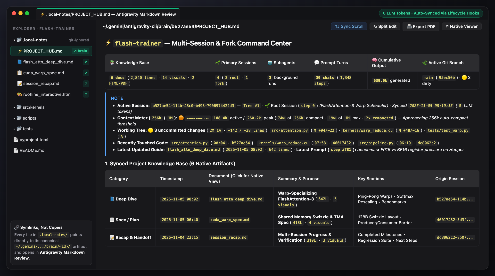
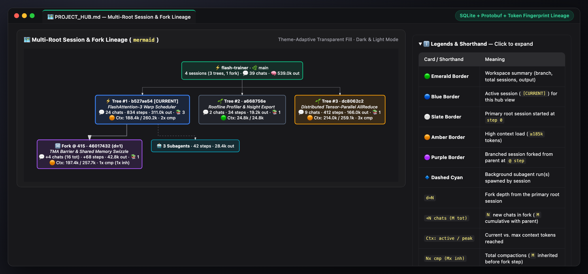
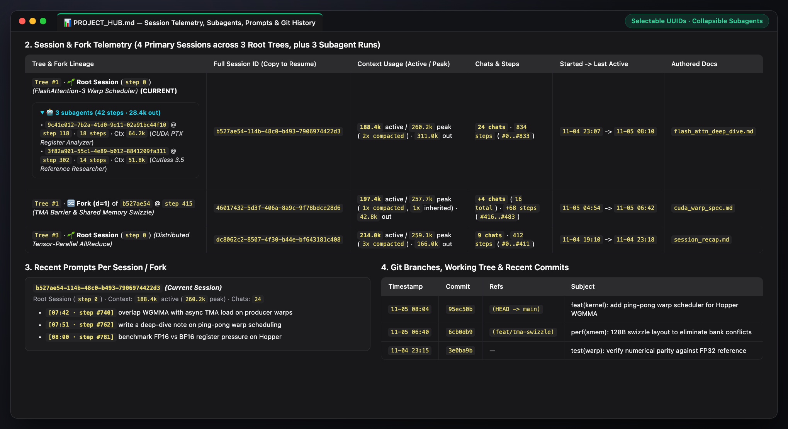

# agy-project-hub

If you run multiple sessions or forks on the same project in Google Antigravity, your notes, plans, and deep dives end up scattered across random `~/.gemini/antigravity-cli/brain/<session-id>/` folders. Worse, if you copy those `.md` files into your workspace to keep track of them, VS Code opens them as plain text instead of using Antigravity's styled Artifact Viewer.

`agy-project-hub` fixes this without burning your context window.

It drops a lightweight `.local-notes/` folder into your project containing shortcuts back to the original brain artifacts, and keeps a single `PROJECT_HUB.md` dashboard updated with every note, session, fork tree, and context token count across the repo.



## What it does

- **Shortcuts instead of copies:** `.local-notes/` holds symlinks pointing straight to the original files in `brain/<session-id>/` (including `PROJECT_HUB.md`), so there is only ever one source of truth.
- **Bundled VS Code extension (`Antigravity Markdown Review`):** Installs `iamqazolp.agy-markdown-review` (`vscode-extension/`) into `~/.vscode/extensions/`. It applies Antigravity's Artifact Viewer design system (callout alerts, rounded tables, code blocks with copy headers, carousels, and clickable `file://` + `conversation://` links) across **every** Markdown review in VS Code—including its own `antigravity.markdownReview` custom editor, VS Code's built-in Markdown Preview, and Markdown Preview Enhanced.
- **Updates automatically in the background:** Registers lightweight `PostInvocation`, `PostToolUse`, and `Stop` hooks in `~/.gemini/config/hooks.json`. Even if the agent forgets to update the hub, the hook updates `PROJECT_HUB.md` and conversation/context usage after every turn.
- **Zero context overhead:** All transcript scanning, SQLite lineage decoding, and file syncing happen in an external Python script (`scripts/sync_local_notes.py`). It costs `0` LLM tokens when idle or running in hooks.
- **Doesn't pollute git:** Adds `.local-notes/` to `.git/info/exclude` locally so your tracked `.gitignore` stays untouched.

## Installation

```bash
git clone https://github.com/iamqazolp/agy-project-hub.git
cd agy-project-hub
python3 install.py
```

Nevermind, just ask your Antigravity agent to install the skill for you. You just give it the repo link and wait 10 minutes.

## Usage

Once installed, everything syncs automatically at the end of each turn. Just open `.local-notes/PROJECT_HUB.md` from your VS Code file explorer to see:

1. **Top-of-Hub General Dashboard:** A 1-row Project Scorecard (`📚 Knowledge Base`, `🌱 Primary Sessions`, `🤖 Subagents`, `💬 Prompt Turns`, `🧠 Cumulative Output`, `🌿 Active Git Branch`) plus a live status callout with a **Visual Context Meter (`256k` / `1M`)**, **Live Working Tree & Uncommitted Diff Strip**, **Recently Touched Code ("Hot Files")**, **Latest Updated Guide**, and **Latest User Prompt**.
2. **Knowledge Base & HTML/PDF Index:** Every Markdown note and interactive HTML/PDF export across all sessions for the project, grouped into Recaps, Deep Dives, and Specs/Plans.
3. **Session & Fork Telemetry:** A spacious multi-line Mermaid fork forest and table showing every root session and fork (with background subagent runs neatly tucked into collapsible `<details>` dropdowns) and selectable inline-code session IDs.
4. **Recent Prompts, Branches & Commits:** The last 5 prompts per session plus local Git branches and the last 8 commits on the active branch.





You can also ask the agent directly in chat:
- *"Recap our progress across all sessions"*
- *"Write a deep-dive note on the data pipeline and sync local notes"*

Or run the sync script manually from a terminal:

```bash
python3 ~/.gemini/config/skills/agy-project-hub/scripts/sync_local_notes.py --workspace /path/to/repo
```

## How fork lineage is reconstructed

When you have multiple root sessions and forks on the same repo, `sync_local_notes.py` figures out which session forked from where in three steps:

1. **SQLite `parent_references`:** Reads `~/.gemini/antigravity-cli/conversation_summaries.db` and `conversations/<session-id>.db` to decode the exact parent UUID and fork step.
2. **Transcript references:** Falls back to scanning opening context summaries in `transcript.jsonl` if the `.db` entry isn't available.
3. **Token + timestamp fingerprinting:** Matches cumulative token counts (`input + cache_read + output`) at the fork step against candidate parent sessions.

## Architecture

```text
agy-project-hub/
├── SKILL.md                      # Skill instructions loaded by Antigravity (~17 lines)
├── install.py                    # Symlinks the skill package into ~/.gemini/config/skills/agy-project-hub
├── README.md                     # This file
├── scripts/
│   ├── sync_local_notes.py       # Thin CLI entrypoint & backwards-compatible façade
│   └── local_recap/              # Modular Python package
│       ├── __init__.py
│       ├── models.py             # Typed @dataclass models & formatting helpers
│       ├── git_telemetry.py      # Branch tips, recent commits, & working tree diff state
│       ├── sqlite_metadata.py    # SQLite conversation_summaries.db & protobuf lineage decoder
│       ├── transcript_scanner.py # Transcript parser & Multi-Root Fork/Subagent Forest builder
│       ├── artifact_sync.py      # Canonical Markdown/HTML/PDF discovery & .local-notes/ shortcuts
│       ├── hub_renderer.py       # General Dashboard, 256k/1M context meter, & PROJECT_HUB.md renderer
│       └── cli.py                # CLI parser, workspace sync runner, & lifecycle hook handler
├── tests/
│   └── test_local_recap.py       # Unit & end-to-end integration test suite
├── resources/
│   └── viz_template.html         # HTML template for standalone diagrams
├── media/
│   └── screenshots/              # README showcase screenshots
└── vscode-extension/             # "Antigravity Markdown Review" VS Code extension
    ├── package.json
    ├── extension.js
    └── media/
        ├── antigravity-markdown.css
        └── antigravity-markdown.js
```
